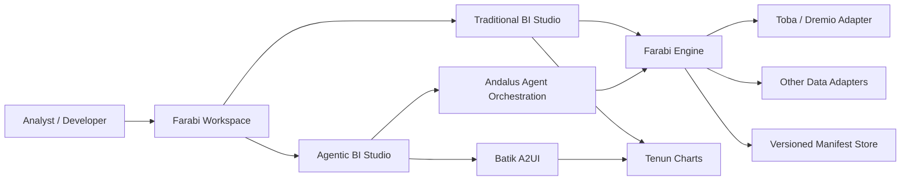
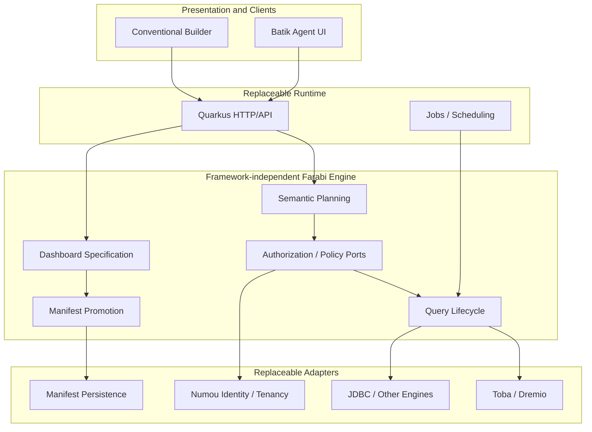
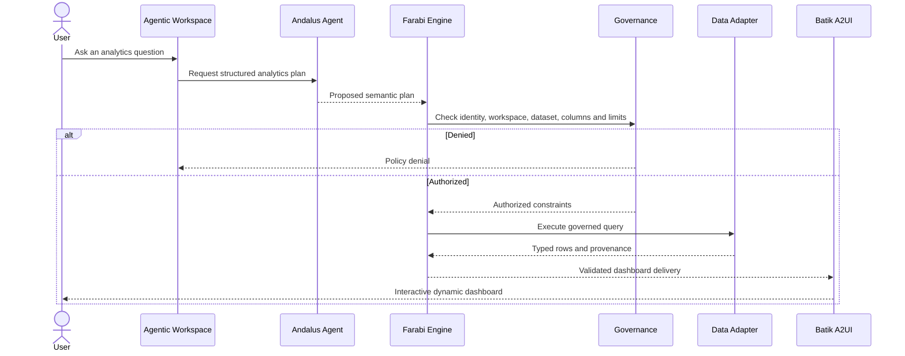
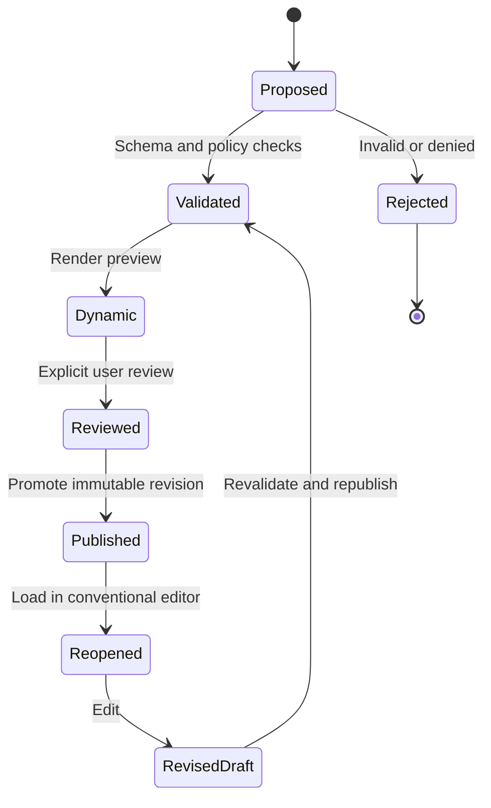

# Farabi Architecture Blueprints

> Target architecture, not a claim that every component is implemented. Farabi unifies conventional and agentic BI around governed analytics and durable dashboard manifests.

## System context

## Hexagonal component boundaries

## Governed prompt-to-dashboard sequence

## Dynamic-to-static artifact lifecycle

## Key invariants

- All data access and chart filters are governed on the server, not trusted to client widgets.
- Published manifests are immutable and versioned; editing creates a new revision.
- Workspace and subject identities originate from trusted authentication, not user-controlled request fields.
- Batik and Tenun are presentation adapters; neither defines semantic policy.
- Toba is an independent data platform, not a Farabi submodule.

## Verification roadmap

1. Restore passing Java and Flutter CI.
2. Demonstrate a governed query with denied-access and cross-tenant tests.
3. Demonstrate conventional dashboard create/edit/save.
4. Demonstrate agent-produced Batik dashboard and explicit promotion.
5. Prove reopened manifest fidelity, provenance and policy enforcement.
