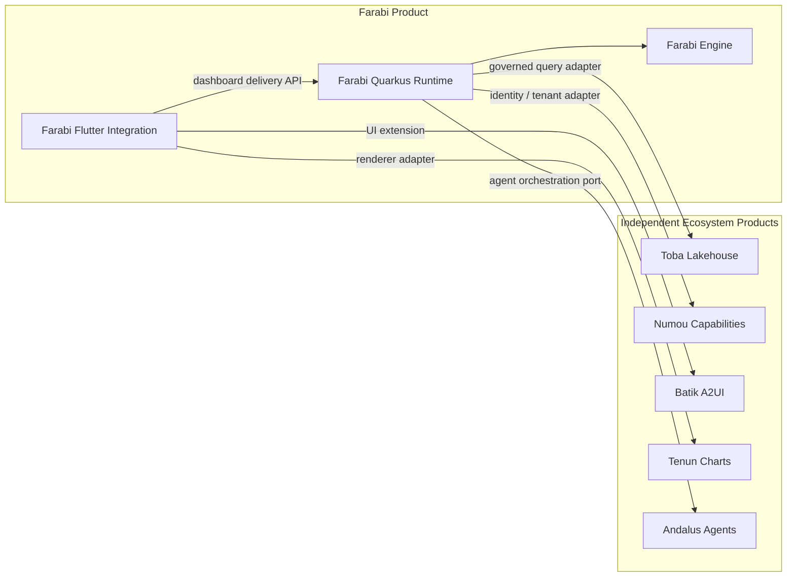
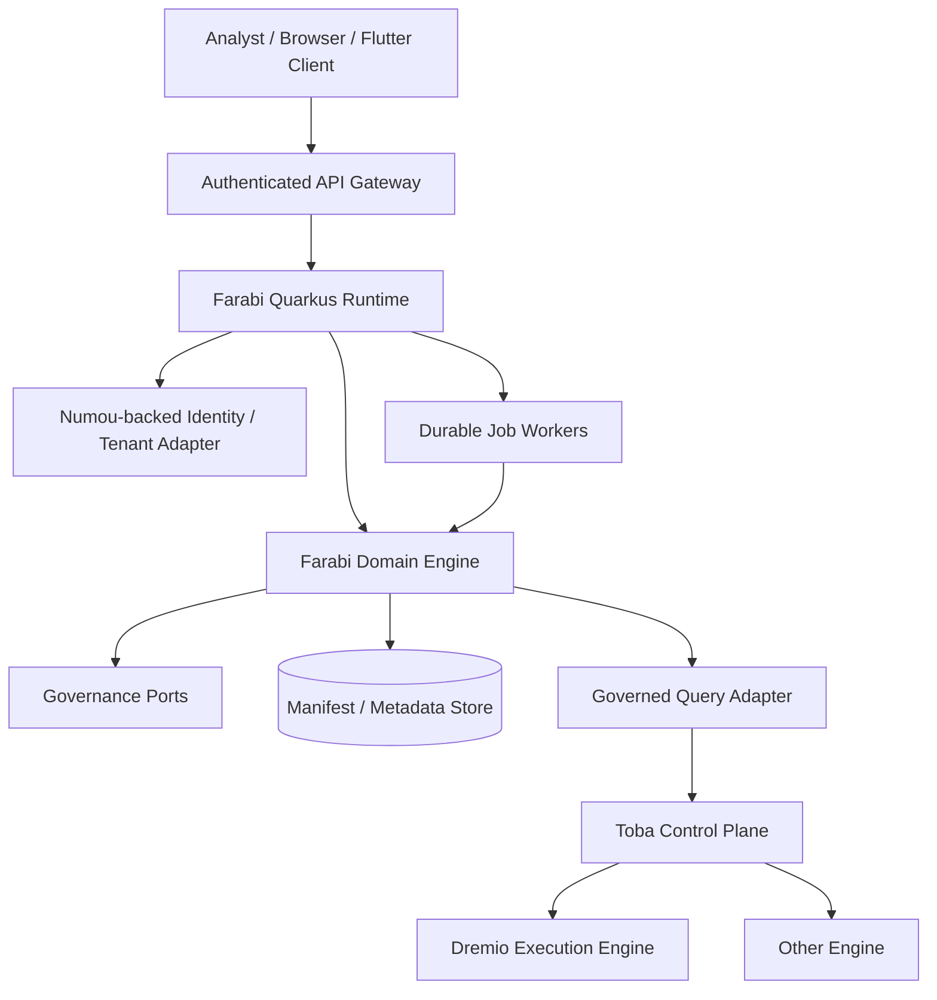
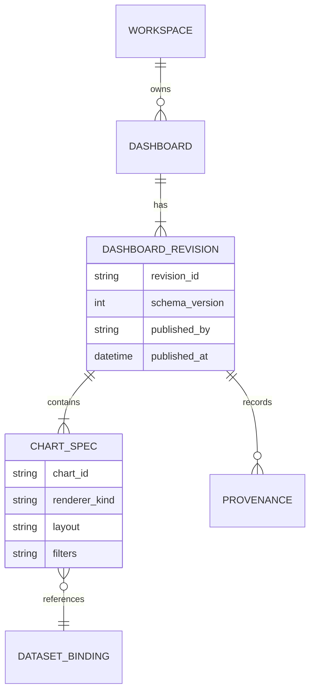

# Andalus Analytics Ecosystem — Integration and Deployment Views

These are **target architecture** diagrams. Each repository is independently versioned and deployable where applicable.

## Dependency direction

**No reverse dependencies:** Toba, Numou, Batik and Tenun must remain independent of Farabi.

## Example deployment topology

Deployment nodes are illustrative, not required one-to-one services. Domain authorization must remain authoritative in the backend regardless of gateway or client controls.

## Dashboard artifact revision model

Conceptual entities; actual database schema and naming are defined by implemented migrations.

## Contract ownership matrix

| Contract | Owner | Consumer | Required property |
| --- | --- | --- | --- |
| Semantic query / policy | Farabi engine | Runtime, agents | Server-side authorization |
| Manifest schema / revisions | Farabi engine | Builder, runtime | Immutable published snapshots |
| A2UI node schema | Batik | Farabi Flutter adapter | Bounded validated input |
| Chart configuration | Tenun | Farabi Tenun adapter | Versioned renderer mapping |
| Query/catalog APIs | Toba | Farabi data adapter | Tenant-scoped execution |
| Identity / tenant capabilities | Numou | Farabi, Toba adapters | Trusted context and isolation |

## Verification boundaries

A passing unit test for a renderer adapter does not establish full compatibility with Batik, Tenun, Toba or Numou. Integration verification requires pinned dependency versions, executable tests, denied-access scenarios, and CI evidence.
