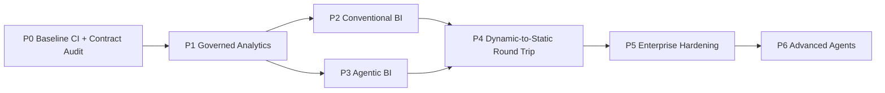
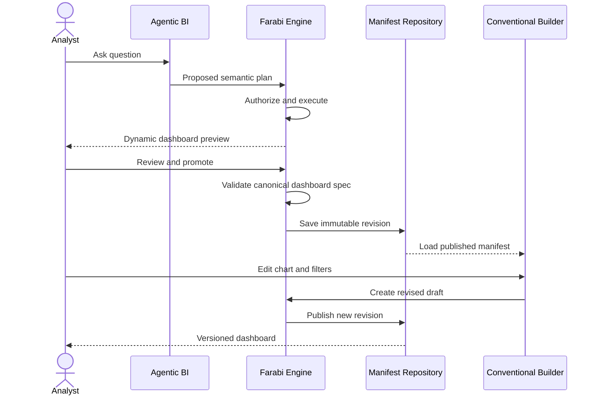
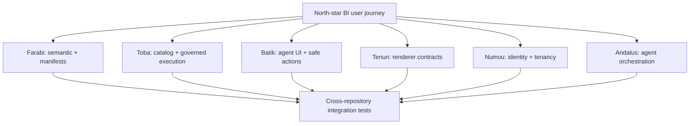

# Farabi Ecosystem — Executable Implementation Plan

> **Status:** Proposed execution plan, not a claim of completed features. Applies across Farabi, Toba, Batik, Numou, Tenun and agent orchestration integrations. Preserve independent repositories and versioned interfaces.

## North-star acceptance scenario

An authenticated analyst requests “show revenue by region for the last 12 months and compare with the prior period.” An agent generates a **structured semantic query plan**, the server validates policy and limits, a governed adapter executes it, Batik renders the dynamic dashboard with Tenun charts, the analyst explicitly reviews/promotes the dashboard to an immutable manifest, reopens it in the conventional editor, edits and publishes a new revision, and a second workspace is denied access.

## Critical path

## Repository responsibility and dependency map

| Repository | Owns | Planned integration |
| --- | --- | --- |
| Farabi | semantic analytics, dashboard lifecycle, manifests, workspace and application APIs | consumes versioned ports |
| Toba | governed multi-engine lakehouse, catalog, workload execution | data/query adapter consumed by Farabi |
| Batik | Flutter A2UI protocol, node validation, component registry, action dispatch | Farabi custom component extension |
| Tenun | chart renderer, chart configuration and extensibility | Farabi chart adapter; no reverse dependency |
| Numou | reusable identity, tenant and business capability contracts | trusted identity/tenant adapter |
| Andalus | agent orchestration and model/tool abstractions | Farabi governed tools and semantic plans |

## P0 — Stabilize and inventory

**Deliverables**
- Repair all reproducible compiler/test failures, including the known manifest schema constant reference if still present.
- Inventory current API/manifest schemas and runtime dependencies against repository reality.
- Run Java Maven CI and both Flutter package suites; document commands, versions and actual results.
- Add architecture decision records for semantic query plans, A2UI envelope and promotion revision semantics.
- Record missing integration credentials or repository permissions explicitly.

**Exit gate:** CI passes for supported modules; all remaining failing or skipped checks are documented with owners and blockers.

## P1 — Governed analytics vertical slice

**Farabi:** Define typed dataset/catalog, semantic measures/dimensions, filters, time grain, query plans, policy decisions, typed result sets and provenance. Implement deterministic semantic compilation and authorization before execution. Bind identity from authenticated server context, never client-supplied subject/workspace fields.

**Toba:** Provide versioned catalog and query/job adapter capabilities; map authorization scope, query limits, cancellation, polling and result paging. Support a real execution engine without leaking vendor DTOs into Farabi.

**Tests:** permitted dataset; denied column; cross-workspace; invalid filter; row limit; cancellation; timeout; idempotency; provenance.

**Exit gate:** a real governed query returns typed results and denial tests prove no unauthorized source execution.

## P2 — Conventional dashboard builder

**Farabi:** Implement dataset explorer, chart authoring, layout, dashboard filters, drafts, revision history, save/publish/reopen, and workspace-scoped retrieval. Maintain one canonical `DashboardSpec` independent of UI toolkit.

**Tenun adapter:** Map canonical chart specs into verified version-pinned renderer contracts; support bar, line, area, pie, scatter, table and KPI where appropriate. Document renderer capability negotiation and unsupported options.

**Tests:** create/edit/save/reopen, filter semantics, revision immutability, invalid layout, missing binding, renderer compatibility.

**Exit gate:** analyst builds and publishes a dashboard without using an AI agent.

## P3 — Agentic BI

**Andalus integration:** Implement governed Farabi tools (catalog discovery, semantic plan proposal, query execution, visualization proposal). Validate all agent output and require policy checks before execution.

**Batik integration:** Produce schema-validated A2UI dashboard nodes; support controlled interactions and bounded UI updates; deny unregistered components and unauthorized actions.

**Tests:** malformed plan, hallucinated dataset, unauthorized field, oversized A2UI payload, invalid action, successful dynamic dashboard rendering.

**Exit gate:** natural-language request produces a live governed dashboard with observable provenance and no arbitrary SQL execution.

## P4 — Dynamic-to-static promotion

**Farabi:** Review and validate dynamic visualization specs, preserve data bindings/filters/layout/provenance, persist immutable versioned manifests, reopen in conventional editor, edit into a new draft/revision, and publish/share with policy checks.

**Tests:** round-trip structural equality, provenance fidelity, no mutation of published revision, concurrent promotion, replay/idempotency, denied cross-workspace access.

**Exit gate:** north-star user journey works across agentic and conventional UI.

## P5 — Enterprise hardening

**Numou integration:** trusted identity, tenant membership, permission evaluation and shared capabilities via versioned adapters. Avoid hard-coding Numou implementation into the Farabi core.

**Farabi/Toba:** audit events, RBAC/ABAC, quotas, cache scoping, durable jobs, scheduling, retry/reconciliation, metrics, tracing, migrations, backup/recovery and deployment controls.

**Tests:** tenant isolation, privilege revocation, job lease fencing, retry idempotency, audit integrity, upgrade/migration, load and failure recovery.

**Exit gate:** security and operational readiness reviewed with evidence.

## P6 — Advanced agentic analytics

Explainable anomaly detection, proactive insights, reusable analytical workflows, multi-step agent plans and assisted dashboard evolution. All tools remain subject to the same governed semantic/query ports and explicit action permissions.

## Workstream ownership

## Recommended consolidated implementation batches

| Batch | Contents | Required evidence |
| --- | --- | --- |
| B0 | CI fixes, repository audit, contract tests | passing Java/Flutter checks |
| B1 | semantic models, governance, Toba adapter, typed results | real query + denial tests |
| B2 | conventional builder, manifests, Tenun adapter | save/reopen/edit/publish test |
| B3 | agent tools, Batik dynamic dashboard, safe actions | natural-language integration scenario |
| B4 | promotion, round-trip, revisioning, sharing | end-to-end north-star scenario |
| B5 | Numou integration, audit, jobs, operations | security and failure-recovery suite |

Avoid small PRs for individual adapters. Use cohesive feature branches and request approval before opening a PR. Do not combine unrelated repositories into one commit or assume cross-repo changes deploy atomically.

## Definition of done and evidence ledger

For every batch, record: objective; repository/branch/commit; schema/API changes; test commands and outcomes; CI links; real adapter validation; security tests; known limitations; deployment and migration implications. Label progress as **planned**, **committed**, **compiled**, **tested**, **integration-verified**, or **production-ready** accurately.

**Never equate a Mermaid diagram, mock, adapter factory, or unexecuted test with a completed product capability.**
