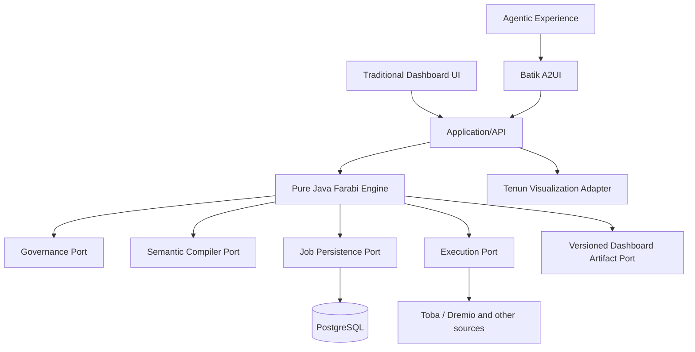

# Architecture and bounded contexts

## Dependency rules
- `engine` contains immutable domain contracts, ports and use cases. No framework or infrastructure imports.
- `runtime-core` assembles ports for embedded Java hosts.
- Adapters implement outbound ports and may use vendor SDKs, JDBC and HTTP.
- `runtime-quarkus` is a default deployment/composition root, not a mandatory engine dependency.
- UI and agents consume governed application APIs; agents must never call a raw execution adapter directly.

## Bounded contexts
**Catalog/Semantics** owns datasets, dimensions, measures, row policies, versioned model definitions and SQL compilation.
**Execution** owns authorized plans, query jobs, provider job references, cancellation, reconciliation and results.
**Visualization** owns chart specifications, data bindings, layout, interactivity and rendering contracts.
**Dashboard** owns drafts, publication, immutable revisions, access controls and refresh configuration.
**Agent** owns prompts, planning, tool approvals, explanations and provenance.
**Platform** owns tenancy, authentication, audit, policy, scheduling, telemetry and deployment.

## Query trust boundary
Caller identity -> trusted auth context -> policy evaluation -> semantic compilation -> source consistency -> durable intent -> remote execution. A request's `workspaceId` and `subjectId` must be derived from authenticated context at the API boundary, never blindly trusted from request bodies.

## Reliability boundary
Persist-before-submit is not exactly-once delivery. A remote acceptance followed by a timeout leaves an ambiguous `PENDING` job. Production requires provider correlation/idempotency, fencing, lease renewal, operator reconciliation and audit.

## Deployment
Standalone Quarkus deployment with PostgreSQL, Dremio/Toba, agent gateway and frontend, or embedded Java runtime with alternate adapters. All secrets via secret management, TLS enforced for remote calls.
