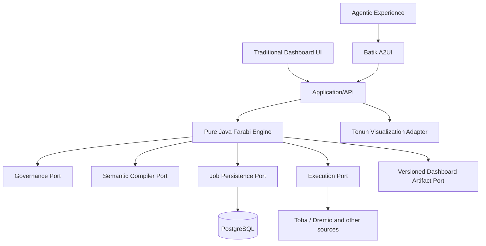

# Architecture and bounded contexts

## Dependency rules
- `engine` contains immutable domain contracts, ports and use cases. No framework or infrastructure imports.
- `runtime-core` assembles ports for embedded Java hosts.
- Adapters implement outbound ports and may use vendor SDKs, JDBC and HTTP.
- `runtime-quarkus` is a default deployment/composition root, not a mandatory engine dependency.
- UI and agents consume governed application APIs; agents must never call a raw execution adapter directly.

## Bounded contexts
**Catalog/Semantics** owns datasets, dimensions, measures, row policies, versioned model definitions and SQL compilation.
**Execution** owns authorized plans, query jobs, provider job references, cancellation, reconciliation and results.
**Visualization** owns chart specifications, data bindings, layout, interactivity and rendering contracts.
**Dashboard** owns drafts, publication, immutable revisions, access controls and refresh configuration.
**Agent** owns prompts, planning, tool approvals, explanations and provenance. The Statistical Intelligence capability owns method registry metadata, typed analysis plans, diagnostics, reproducible statistical execution and research-result artifacts; the agent proposes methods but deterministic services validate and execute them.
**Platform** owns tenancy, authentication, audit, policy, scheduling, telemetry and deployment.

## Query trust boundary
Caller identity -> trusted auth context -> policy evaluation -> semantic compilation -> source consistency -> durable intent -> remote execution. A request's `workspaceId` and `subjectId` must be derived from authenticated context at the API boundary, never blindly trusted from request bodies.

## Reliability boundary
Persist-before-submit is not exactly-once delivery. A remote acceptance followed by a timeout leaves an ambiguous `PENDING` job. Production requires provider correlation/idempotency, fencing, lease renewal, operator reconciliation and audit.

## Deployment
Standalone Quarkus deployment with PostgreSQL, Dremio/Toba, agent gateway and frontend, or embedded Java runtime with alternate adapters. All secrets via secret management, TLS enforced for remote calls.

## Andalus integration: optional agent runtime, not an analytics authority

Farabi is the analytics/research product and remains independently deployable. Andalus is a neutral agent runtime and orchestration foundation that Farabi may use for agent execution or cross-domain delegation. Farabi must not become a thin Andalus plugin, and Andalus must not own Farabi's analytics semantics, governance or canonical artifacts.

### Integration surfaces

Farabi may expose selected governed tools, a specialist analytics/research agent, and/or its complete product APIs and UI. These are complementary surfaces:

- **Tools:** narrow operations that call Farabi application use cases, such as catalog discovery, semantic exploration or requesting an authorized analysis.
- **Specialist agent:** a bounded research/analytics task delegated to Farabi. Farabi owns its method selection, semantic validation, governed execution and result production.
- **Complete product:** conventional BI, agentic BI, dashboard editing, publication and sharing remain Farabi product workflows.

Agents must never call raw JDBC, unrestricted SQL or source adapters directly. All data access must pass through Farabi's application and governance boundaries.

### Deployment options

| Mode | Integration | Appropriate use |
|---|---|---|
| Embedded | In-process adapter where JDK/BOM/API compatibility is proven | Local or single-process deployments |
| Local sidecar | Separate process over local IPC/gRPC/HTTP | Isolation or independent runtime lifecycle |
| Remote service | Versioned HTTP/gRPC with streaming and cancellation | Shared deployments and independent scaling |
| Interoperability adapter | MCP/A2A adapters where useful | External tool/agent compatibility, not the core domain model |

All modes use the same Farabi-owned domain contracts. The transport must not leak into the engine domain model. Given the currently documented Java 21 Farabi versus Java 25 Andalus compatibility gap, remote integration is the safe initial option until a common JDK/BOM and complete compatibility test are established.

### Authority and state

- Andalus owns generic agent execution, model routing, orchestration, delegation lifecycle and cross-domain coordination.
- Farabi owns dataset/catalog semantics, research intent, method validation, query planning, BI policy, authorized execution, statistical result provenance, dashboard manifests, revisions, review and publication.
- NumU remains the candidate reusable platform foundation for identity/tenancy where compatible; Farabi still validates trusted principal context and owns BI-specific authorization.
- Aljabr remains the shared mathematical/statistical/ML computation engine; it does not own Farabi's product workflows.
- Andalus task records may hold correlation IDs, delegation status and references to Farabi artifacts. Farabi remains the canonical owner of datasets, semantic models, query jobs, research artifacts and dashboard state.

Every invocation must receive server-validated tenant, actor, workspace, correlation ID, allowed capabilities, policy constraints, budget, deadline and cancellation context. Client- or prompt-supplied identity is never authoritative. Farabi must re-authorize each data and publication operation even when the request originates from an authorized Andalus agent.

### Integration rollout

1. Keep Farabi fully functional without Andalus.
2. Stabilize Farabi-owned application APIs and policy-enforced use cases.
3. Define a versioned Farabi agent/tool adapter contract and trusted execution context.
4. Start with remote Andalus Runtime integration while Java/BOM compatibility is unresolved.
5. Add embedded integration only after JDK, dependency, security-context, lifecycle and test compatibility are demonstrated.
6. Add streaming, cancellation, idempotency, reconciliation and audit correlation.
7. Scale analytics workers independently from generic orchestration and coding workers.

Integration status must be documented as proposed, implemented, tested or production-verified; do not imply a capability exists merely because an adapter or candidate dependency is documented.
