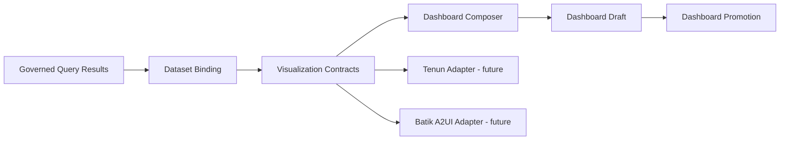

# R4 — Visualization and dashboard composition contracts

## Delivered
- Engine-neutral chart kinds, data bindings, simple filter predicates, 12-column grid placements and dashboard layout validation.
- A composition use case maps a validated visualization specification to the existing immutable dashboard draft model.
- Renderer SPI can be implemented by Tenun, Batik or other clients without adding UI dependencies to the Java engine.
- Tests cover layout overlaps, duplicate/missing placement, grid bounds and immutable input snapshots.

## Architecture

## Important constraints
This PR provides **contracts and composition**, not actual Tenun or Batik rendering. The existing published dashboard schema stores only minimal chart definitions; it does not yet persist layout, filters or the full visualization spec. Therefore the returned `Composition` carries the rich spec separately, and callers must not assume a published artifact preserves its layout.

Filters are UI contract metadata only: they are **not compiled into SQL**, and must not be used to bypass row/column policy enforcement.

## Next milestone
Introduce a versioned visualization manifest with durable layout/binding persistence, chart renderer adapters, trusted query-result binding and dynamic-to-static promotion preserving the entire manifest.
