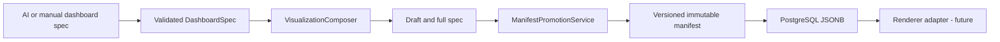

# R5 — Versioned visualization manifest and dynamic-to-static promotion

## Problem solved
R4 composition returned a rich DashboardSpec but the legacy artifact store persisted only minimal chart fields. R5 adds a separate versioned, immutable manifest store that persists the complete chart bindings, filters, layout and prompt provenance.

## Flow

## Contract
- Schema version 1, immutable Java records and workspace-scoped repository lookup.
- PostgreSQL JSONB stores the full DashboardSpec; unique workspace/draft/revision constraint.
- ManifestPromotionService enforces draft owner and workspace identity as supplied by a trusted caller.
- Revisions are append-only snapshots; no mutable overwrite API.
- AI prompt provenance is recorded as metadata, not treated as an instruction on replay.

## Security and production caveats
- Authentication and principal binding remain the runtime's responsibility.
- Visualization filters are metadata, not authorization or row-level SQL predicates.
- A schema version identifies the manifest shape; it does not pin source dataset revisions or query results.
- The manifest store is separate from legacy farabi_dashboard_artifacts; no migration/backfill of legacy records.
- No Batik/Tenun renderer, signed manifests, trusted AI agent execution, retention policy or PostgreSQL integration test is included.
- Migration V4 requires prior V1–V3 migrations.
