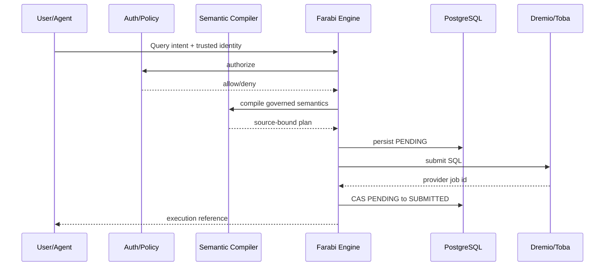
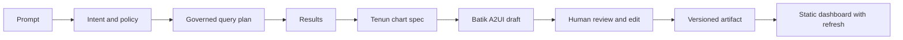

# Key workflows

## Governed query submission

## AI to durable dashboard

Promotion must capture semantic model revision, data source references, query plan hash, chart specs, layout, policy snapshot reference, creation actor, prompt provenance and refresh strategy. A static artifact is a durable **definition**, not a promise that underlying data never changes.

## Conventional authoring
Choose dataset -> define dimensions/measures -> preview authorized query -> compose Tenun charts -> save dashboard draft -> review/publish -> schedule refresh.

## Worker lifecycle (target)
Claim with fenced lease -> renew lease -> poll provider -> write conditional state transition -> publish result metadata -> release. Stale worker writes must be rejected.
